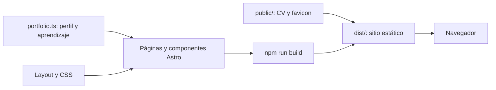

# Portafolio DevOps

Portafolio personal en español para presentar el camino de Dylan0247 hacia DevOps,
su formación en curso y el caso práctico Cerebro. Reúne proyectos, objetivos,
CV y vías de contacto para oportunidades de empleo y freelance.

Construido con Astro, TypeScript y CSS; genera páginas estáticas listas para alojar.
La formación se presenta como preparación u objetivo, sin atribuir certificaciones obtenidas.

## Recorrido por la web

| Ruta | Qué puedes hacer |
| --- | --- |
| `/` | Explorar el proyecto, la formación, la presentación personal y las preguntas frecuentes |
| `/#contacto` | Abrir el correo, visitar GitHub, llamar desde un dispositivo compatible y consultar el CV |
| `/proyectos/cerebro/` | Leer el problema, las piezas, el método y los límites de Cerebro |
| `/cv/Cv_Dilan_dev.pdf` | Abrir o descargar el CV público |

Por ejemplo: desde **Explorar proyectos**, abre **Leer el caso práctico** para conocer
Cerebro; vuelve al inicio y pulsa **Contáctame** para llegar a los datos de contacto.
Las preguntas frecuentes usan elementos HTML `details` y `summary`.
El correo y el teléfono abren aplicaciones del dispositivo; no hay formulario que envíe datos.

## Arquitectura y flujo



1. Las páginas importan el contenido de `src/data/portfolio.ts` y reutilizan el layout.
2. Astro genera HTML y CSS durante la compilación; copia los recursos de `public/` a la salida.
3. El navegador muestra las páginas y sigue sus enlaces. Las interacciones actuales
   se resuelven con HTML y CSS, sin scripts de cliente propios.

`Pipeline.astro` dibuja un esquema conceptual de **Cerebro**, el proyecto descrito.
Obsidian, n8n, Ollama, Qwen3 y MCP pertenecen a ese caso práctico: no son dependencias
de ejecución del portafolio. La web no consulta la memoria privada ni utiliza un backend o una base de datos.

## Ejecutar en local

Desde la carpeta del proyecto, con Node.js y npm instalados:

```sh
npm ci
npm run dev
```

El manifiesto declara Node.js `>=22.12.0`. El entorno utilizado para comprobar el
proyecto tiene Node.js `24.12.0` y npm `11.6.2`.
`npm ci` instala las versiones de `package-lock.json`.

Abre la dirección que muestre Astro; en la sesión local se utiliza
`http://127.0.0.1:4321/`. El servidor se limita a `127.0.0.1`.
Detén el proceso con `Ctrl+C`. No se necesitan variables de entorno ni claves de API.

### Comandos disponibles

| Comando | Función |
| --- | --- |
| `npm run dev` | Desarrollo local con actualización al editar |
| `npm run check` | Diagnóstico de Astro y TypeScript mediante `astro check` |
| `npm run build` | Compilación estática en `dist/` |
| `npm run preview` | Servir localmente la compilación existente |

Para revisar la salida de producción:

```sh
npm run check
npm run build
npm run preview
```

Abre la dirección que indique `preview`. Comprueba el caso práctico, los enlaces de
contacto, la apertura y descarga del CV, la navegación por teclado y la vista móvil.
El repositorio no incluye una suite de tests, un script de lint ni una configuración de CI;
`check` y `build` comprueban tipos y compilación, pero no sustituyen esa revisión de uso.

## Stack y estructura

| Área | Implementación |
| --- | --- |
| Generación del sitio | Astro `7.3.8`, salida `static` |
| Tipos | TypeScript `5.9.3`, configuración `strict` de Astro |
| Diagnóstico | `@astrojs/check` `0.9.10` |
| Interfaz | Componentes `.astro`, HTML semántico y CSS propio |
| Diseño | Referencia en `DESIGN.md`, adaptaciones en `docs/decisiones.md` |
| Destino previsto | GitHub para el código y Vercel para el sitio |

Las versiones anteriores corresponden al lockfile actual.

```text
.
├── src/
│   ├── data/portfolio.ts          # Perfil, aprendizaje y proyecto
│   ├── pages/                    # Inicio y caso práctico Cerebro
│   ├── layouts/Layout.astro      # Metadatos, cabecera y pie comunes
│   ├── components/Pipeline.astro # Diagrama conceptual de Cerebro
│   └── styles/global.css         # Tokens, estilos y adaptación a móvil
├── public/                       # CV público y favicon
├── docs/decisiones.md             # Alcance y decisiones de implementación
├── .codex/agents/                # Roles opcionales de trabajo
├── .agents/skills/               # Procedimiento de revisión
├── AGENTS.md                     # Instrucciones comunes para Codex
├── DESIGN.md                     # Referencia visual original
├── astro.config.mjs              # Generación estática
└── vercel.json                   # Framework, build y carpeta de salida
```

### Dónde editar

| Archivo | Uso |
| --- | --- |
| src/data/portfolio.ts | Identidad, enlaces, formación y proyecto |
| src/pages/index.astro | Página principal |
| src/pages/proyectos/cerebro.astro | Caso práctico Cerebro |
| src/styles/global.css | Tokens y estilos responsive |
| DESIGN.md | Referencia visual original |
| AGENTS.md | Reglas de trabajo para Codex |
| .codex/agents/ | Roles de frontend, contenido y revisión |
| .agents/skills/revisar-portafolio/SKILL.md | Procedimiento de revisión |
| docs/decisiones.md | Alcance y decisiones de implementación |
| public/cv/Cv_Dilan_dev.pdf | CV accesible desde la web |

- Edita `profile`, `learning` y `cerebro` en `src/data/portfolio.ts`.
  Mantén separadas formación en curso, próximos objetivos y certificaciones obtenidas.
- Para sustituir el CV, coloca el PDF destinado a publicación en `public/cv/`
  y ajusta `profile.cv`. Su URL comienza por `/cv/`, sin el prefijo `public/`.
- Si cambias el teléfono, actualiza tanto `phone` como `phoneHref` con formato `tel:`.
- Para cambiar el diseño, lee [DESIGN.md](DESIGN.md) y las
  [decisiones de implementación](docs/decisiones.md) antes de editar `global.css`.

El campo `profile.linkedin` define la tarjeta de LinkedIn en contacto; si está vacío, se oculta.
El texto visible del enlace de GitHub en contacto está escrito en `index.astro`;
si cambias de cuenta, actualízalo junto con `profile.github`.

El CSS incluye puntos de adaptación a móvil, foco visible y una regla para movimiento
reducido. Las fuentes son Georgia y Courier New con alternativas del sistema;
las sustituciones respecto al diseño original están documentadas en las decisiones.

## Trabajar con agentes y skills

Lee primero [AGENTS.md](AGENTS.md). Las responsabilidades opcionales del proyecto son:

| Recurso | Responsabilidad |
| --- | --- |
| `.codex/agents/frontend.toml` | Interfaz Astro conforme al diseño |
| `.codex/agents/contenido.toml` | Perfil y casos prácticos sustentados en hechos |
| `.codex/agents/revisor.toml` | Revisión en modo de solo lectura |
| `.agents/skills/revisar-portafolio/SKILL.md` | Procedimiento de revisión del contenido, diseño y funcionamiento |

Abre esta carpeta como proyecto. Ejemplos de peticiones:

- «Lee AGENTS.md y DESIGN.md y cambia la presentación manteniendo el diseño».
- «Usa el agente contenido para proponer una bio basada en src/data/portfolio.ts».
- «Delega la revisión visual a frontend y la revisión de contenido a revisor;
  que no editen archivos y devuelve sus conclusiones».
- «Usa $revisar-portafolio antes de preparar la publicación».

Los archivos de roles definen instrucciones; no son procesos permanentes.
Su disponibilidad depende de la configuración y versión local de Codex.
La creación de estos archivos no implica que se hayan ejecutado subagentes.
Las notas privadas de Cerebro no forman parte del contenido público.

## Publicación prevista

`vercel.json` declara el framework `astro`, `npm run build` como comando de compilación
y `dist` como carpeta de salida. Después de revisar el resultado local:

1. Completa src/data/portfolio.ts con los datos que quieras hacer públicos.
2. Ejecuta SafeGit sobre archivos, índice e historial saliente; después check y build.
3. Sube este proyecto a un repositorio de GitHub elegido por el usuario.
4. Importa ese repositorio en Vercel, framework Astro, build npm run build y dist/.
5. Una vez conocida la URL pública, añade site a astro.config.mjs y metadatos canónicos.

El despliegue en Vercel está pendiente. No se incluye un enlace
de demo pública porque aún no hay uno confirmado. Tampoco se ha definido una licencia
en el repositorio. `site` y las referencias canónicas aún no están configurados.

## Privacidad del repositorio

El CV y los datos de contacto están incluidos expresamente para este portafolio.
Revisa el contenido y los metadatos de cualquier PDF que los sustituya antes de publicarlo.
Las notas de trabajo, capturas, informes locales, dependencias instaladas y builds
quedan fuera de Git. Las reglas de .gitignore no eliminan archivos ya seguidos ni
versiones históricas: revisa siempre el índice y los commits que se van a enviar.
Una modificación posterior exige renovar las comprobaciones de SafeGit afectadas;
documentar o revisar el proyecto no autoriza por sí mismo su publicación.

Referencias: [Astro](https://docs.astro.build/en/install-and-setup/),
[Vercel](https://vercel.com/docs/frameworks/frontend/astro),
[Agentes Codex](https://learn.chatgpt.com/docs/agent-configuration/subagents),
[Skills](https://learn.chatgpt.com/docs/build-skills).
